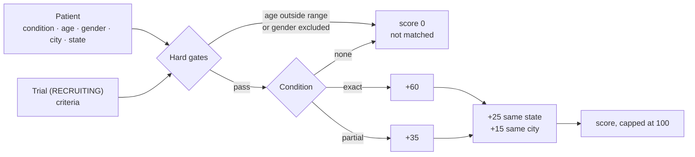

<div align="center">


[](https://git.io/typing-svg)

<!-- ============ STATUS BAR ============ -->
[](https://github.com/rbchy/RbcTcsWorld_ClinTrial-Connect/actions/workflows/tests.yml)


[](README-AUTOMATION.md)
[](%E0%A6%B8%E0%A7%87%E0%A6%9F%E0%A6%86%E0%A6%AA_%E0%A6%97%E0%A6%BE%E0%A6%87%E0%A6%A1.md)
[](ClinTrial_Connect_Test_Cases.xlsx)
[](perf/README.md)
[](LICENSE)


</div>

---

## 📌 At a Glance

<table>
<tr>
<td width="50%" valign="top">

**🙋 What this is**

A clinical-trial **patient-matching web app** — patients register with their condition and location, physicians publish trials, and a scoring algorithm matches the two behind role-based login (**ADMIN · PHYSICIAN · PATIENT**). Loosely modeled on platforms like SiteRx.

It is a **QA practice project first**: a fully self-owned system that can legitimately take a full security, load and automation test suite — SQL-injection attempts, forced browsing, scraping, load testing — the kind of testing that must never be run against someone else's live site.

> *The application is the test object; the work is the test system around it.*

</td>
<td width="50%" valign="top">

**📍 Quick facts**

| | |
|---|---|
| ✅ **Latest run** | 115 / 115 passed · 6.2 s · 12 Sep 2026 |
| 🧪 **Test layers** | 8 (unit → load) |
| 📋 **Manual cases** | 67 in 11 areas, all traced |
| 🐞 **Defects logged** | 5 (3 fixed · 2 documented) |
| 🗄️ **Database** | MySQL 8 (app) · H2 (tests) |
| 🔐 **Auth** | BCrypt · CSRF · RBAC + `@PreAuthorize` |

</td>
</tr>
</table>

> 🚧 **Repository status:** this repository currently holds the build file (`pom.xml`), the QA documentation, the test-case matrix, the Allure results, the JMeter plan and a standalone algorithm check. The application and test source (`src/`) is being uploaded next — until then, the commands below describe how the project is run locally.

---

## ✅ Test Results

<div align="center">


</div>

| Layer | What it proves | Tooling |
|---|---|---|
| Unit | Matching-algorithm scoring, Bean Validation rules on every form | JUnit 5 (no Spring context) |
| Repository | Every custom query method | `@DataJpaTest` on H2 |
| Service | Registration, trials, matching, notifications against a real DB | `@SpringBootTest` |
| Controller | Routing, form binding and validation, redirects, persisted effects | MockMvc |
| Security | Forced browsing, role escalation, SQL-injection safety of the login form | Spring Security Test |
| BDD | Matching rules as readable scenarios, in the same `mvn test` | Cucumber 7 + `cucumber-spring` |
| End-to-end | UI and raw-HTTP flows mapped 1:1 to the manual matrix | Selenium 4 (Page Objects) |
| Data & load | DB integrity over plain JDBC; browse and login under load | JDBC · Apache JMeter |

**Largest suites** (from the Allure overview): `MatchingServiceTest` 17 · `RoleAccessSecurityTest` 9 · `PublicPagesTest` 8 · `PatientRegistrationFormValidationTest` 7 · `RegistrationControllerTest` 7 · `ContactFormValidationTest` 6 · `AdminControllerTest` 6.

**CI on every push** ([workflow](.github/workflows/tests.yml)): the dependency-free [`AlgoCheck`](verify-algorithm/AlgoCheck.java) runs 12 scoring cases, `pom.xml` and all its dependencies must resolve, and the JMeter plan must be well-formed XML. The full `mvn test` (the 115 tests above) switches on automatically once `src/` is in the repository.

📄 Allure exports: [Overview](Allure%20Report%20Overview.pdf) · [Suites](Allure%20Report%20Suites.pdf) · [Behaviors](Allure%20Report%20Behavior.pdf) · [Packages](Allure%20Report%20Packages.pdf) · [Graphs](Allure%20Report%20Graphs.pdf)

---

## 🐞 What the Tests Found

Building the suite against the running app — not just reading the code — surfaced real problems. Full detail in **[README-AUTOMATION.md](README-AUTOMATION.md)**.

| # | Finding | Found by | Outcome |
|---|---|---|---|
| 1 | Closed / draft trials stayed in a patient's match list | TRIAL-04, MATCH-08 |  filtered to `RECRUITING`, history kept for the unique constraint |
| 2 | "Log Out" link did nothing (GET link vs. POST-only logout with CSRF on) | AUTH-11 |  real POST form |
| 3 | Every POST form was missing its CSRF field → 403 on login, registration, contact, trials | full Selenium run |  hidden `_csrf` field in each form |
| 4 | Any physician can review any match (no trial-ownership check) | RBAC-06 |  product decision, asserted explicitly |
| 5 | Unverified physicians are not blocked from acting | PHYS-04 |  product decision, asserted explicitly |

Also noted: no code path creates a `Notification` yet (NOTIF-01) — a feature gap, called out rather than guessed at.

---

## 📋 Manual Test-Case Coverage

All 67 cases in [`ClinTrial_Connect_Test_Cases.xlsx`](ClinTrial_Connect_Test_Cases.xlsx) map to an automated test or the JMeter plan ([traceability matrix](README-AUTOMATION.md#traceability-matrix)).

| Area | Cases | High | Medium / Low | Automated by |
|---|---:|---:|---:|---|
| 🔐 Registration & Auth | 12 | 8 | 4 | `RegistrationAuthAutomationTest` |
| 🛡️ Role-Based Access | 8 | 6 | 2 | `RoleBasedAccessAutomationTest` |
| 🧪 Trial Management | 6 | 4 | 2 | `TrialManagementAutomationTest` |
| 🧮 Matching Algorithm | 9 | 5 | 4 | `MatchingAlgorithmAutomationTest` |
| 🩺 Physician Review | 4 | 2 | 2 | `PhysicianReviewAutomationTest` |
| ⚙️ Admin Console | 4 | 3 | 1 | `AdminConsoleAutomationTest` |
| 📬 Contact & Notifications | 5 | 3 | 2 | `ContactNotificationsAutomationTest` |
| 🔒 Security | 8 | 5 | 3 | `SecurityAutomationTest` |
| ⚡ Performance & Load | 3 | 0 | 3 | `perf/clintrial-load-test.jmx` |
| 🗄️ Database Integrity | 4 | 0 | 4 | `DatabaseIntegrityAutomationTest` |
| ♿ Responsive & A11y | 4 | 0 | 4 | `AccessibilityAutomationTest` (incl. axe-core) |
| **Total** | **67** | **36** | **31** | |

---

## 🧮 Matching Algorithm

Every `RECRUITING` trial is scored 0–100 against the patient's profile:



Age bounds are inclusive at both ends (tested at 17 / 18 / 70 / 71 against `[18, 70]`); a null patient condition never matches; an unknown gender is not excluded. [`verify-algorithm/AlgoCheck.java`](verify-algorithm/AlgoCheck.java) re-implements the scoring with no dependencies so it can be checked with plain `javac`.

---

## ✨ Application Features

<details open>
<summary><strong>🔐 Login, auth & role-based access</strong></summary>

<br>

- Form login, BCrypt password hashing, CSRF protection on every state-changing form
- **ADMIN / PHYSICIAN / PATIENT** enforced at the URL level (`SecurityConfig`) and again per method (`@PreAuthorize`) — defense in depth
- Every real route is listed explicitly; anything else is a normal 404, not a login redirect

</details>

<details>
<summary><strong>🧑‍⚕️ Patients, physicians & trials</strong></summary>

<br>

- **Patient registration:** condition, date of birth, location, consent to contact
- **Physician registration:** license number and specialty; unverified until an admin approves
- **Trials:** age range, gender, condition, location criteria; `DRAFT → RECRUITING → CLOSED` lifecycle

</details>

<details>
<summary><strong>📬 Contact, notifications & admin console</strong></summary>

<br>

- Validated public contact form, reviewable by admins
- Per-user in-app notification feed and an audit log of account / security events
- Admin dashboard: live counts, physician verification, trial status control, and a printable **Platform Summary Report**

</details>

<details>
<summary><strong>🎨 UI & accessibility</strong></summary>

<br>

- Teal → blue theme from one shared stylesheet; Back button on every form page
- Floating **? Help** modal in **English, Bangla, Spanish, Hindi and French**, remembering the chosen language
- Tested for keyboard-only login, `label`/`input` pairing, 375 px mobile width and an axe-core audit

</details>

---

## 🛠️ Tech Stack

| Area | Technology |
|---|---|
| Backend | Java 17 · Spring Boot 3.3.4 (Web MVC, Data JPA, Security, Validation) · Lombok |
| Views | Thymeleaf + `thymeleaf-extras-springsecurity6` · plain CSS |
| Database | MySQL 8 (`mysql-connector-j`) · H2 in-memory for tests |
| Tests | JUnit 5 · MockMvc · Spring Security Test · Cucumber 7 (`cucumber-spring`, JUnit Platform Suite) · Selenium 4.24 |
| Performance | Apache JMeter (browse 20 users · login 10 users) |
| Reporting | Allure 2 (JUnit 5 + Cucumber 7 listeners, `allure-maven` 2.15.0) |
| Build | Maven |

---

## 🚀 Getting Started

**Prerequisites:** JDK 17+ and Maven. MySQL 8 is needed only to run the app — the test suite uses in-memory H2.

<details>
<summary><strong>Run the app with demo data (MySQL)</strong></summary>

<br>

```bash
# 1. Database and app user (plain IDENTIFIED BY — mysql_native_password is gone in MySQL 8.4+)
mysql -u root -p -e "CREATE DATABASE IF NOT EXISTS clintrial_connect CHARACTER SET utf8mb4;"
mysql -u root -p -e "DROP USER IF EXISTS 'clintrial_app'@'%'; CREATE USER 'clintrial_app'@'%' IDENTIFIED BY 'ClinTrialQA@2026'; GRANT ALL PRIVILEGES ON clintrial_connect.* TO 'clintrial_app'@'%'; FLUSH PRIVILEGES;"
mysql -u clintrial_app -p clintrial_connect < src/main/resources/schema-mysql.sql

# 2. Connection settings
export DB_HOST=localhost DB_PORT=3306 DB_NAME=clintrial_connect DB_USER=clintrial_app DB_PASSWORD='ClinTrialQA@2026'

# 3. Start with demo accounts and two sample trials
mvn spring-boot:run -Dspring-boot.run.profiles=mysql,demo
```

Demo accounts (password `Password123!`): `admin@clintrial.test` (ADMIN) · `dr.patel@clintrial.test` (PHYSICIAN, verified) · `patient1@clintrial.test` (PATIENT). Step-by-step in Bangla, including common connection errors: [সেটআপ_গাইড.md](%E0%A6%B8%E0%A7%87%E0%A6%9F%E0%A6%86%E0%A6%AA_%E0%A6%97%E0%A6%BE%E0%A6%87%E0%A6%A1.md).

</details>

<details open>
<summary><strong>Run the tests</strong></summary>

<br>

```bash
mvn test                                   # unit, JPA, service, MockMvc, security, Cucumber (H2)
mvn -Dtest=MatchingServiceTest test        # matching algorithm only
mvn -Dtest=RunCucumberTest test            # Cucumber scenarios only

# End-to-end (needs the app running; excluded from the default run)
mvn -Dtest="selenium.**" -DfailIfNoTests=false -Dbase.url=http://localhost:8080 test

# Database integrity (needs live MySQL; export the DB_* variables in this same terminal)
mvn -Dtest="dbintegrity.**" -DfailIfNoTests=false test

# Load test
jmeter -n -t perf/clintrial-load-test.jmx
```

</details>

<details>
<summary><strong>Allure report</strong></summary>

<br>

```bash
mvn test
mvn io.qameta.allure:allure-maven:2.15.0:serve
```

The fully-qualified goal is used on purpose: the short `mvn allure:serve` depends on Maven resolving the plugin prefix, which does not work on every setup.

</details>

---

## 📂 Repository Contents

```
RbcTcsWorld_ClinTrial-Connect/
├── pom.xml                              Spring Boot 3.3.4 · Java 17 · Allure + Cucumber wiring
├── README-AUTOMATION.md                 test-case ↔ automated-test matrix + defect log
├── সেটআপ_গাইড.md                         Bangla install / run / test guide
├── ClinTrial_Connect_Test_Cases.xlsx    67 manual test cases in 11 areas
├── Allure Report *.pdf                  exported results of the 115-test run
├── perf/
│   ├── clintrial-load-test.jmx          JMeter plan: Browse Trials (20) · Login Flow (10)
│   └── README.md
├── verify-algorithm/AlgoCheck.java      dependency-free check of the scoring logic
├── docs/banner.svg
├── .github/workflows/tests.yml          CI: algorithm check, Maven build, JMeter plan
└── LICENSE                              MIT
```

The application and test source (`src/main/java/com/clintrial/…`, `src/test/java/com/clintrial/…`) follows the layout described in [README-AUTOMATION.md](README-AUTOMATION.md).

---

## 🔗 Related Projects

| Project | Stack |
|---|---|
| ⭐ [RbcTcsWorld E-Commerce Suite](https://github.com/rbchy/RbcTcsWorld_ECommerceSuite) | Spring Boot · REST Assured · Selenium · Playwright · CI quality gates |
| 🏭 [PPES Pharma Packaging](https://github.com/rbchy/PPES-Pharmaceutical-Packaging-Management) | Java 17 · MySQL 8 — production-shaped packaging-line tool |
| 🏥 [OpenEMR Healthcare](https://github.com/rbchy/OpenEMR_Automation) | Java · Selenium · Cucumber · TestNG |
| 🔌 [API — Rest Assured](https://github.com/rbchy/QaBrainsAPIAutomationRestAssured) | Java · Rest Assured · Cucumber |

<sub>All projects: [github.com/rbchy](https://github.com/rbchy)</sub>

---

## 👤 Author

<div align="center">

**Ranajit Baran Chowdhury (RB Chowdhury)**
QA Automation Engineer / SDET · West Norriton, Pennsylvania, USA

[](https://www.linkedin.com/in/rbchy/)
[](https://github.com/rbchy)
[](https://rbchy.github.io/rbchy/)
[](https://rbc6543.wixsite.com/rbc-portfolio)
[](mailto:chyranajit@gmail.com)

<sub>MIT licensed. All patient, physician and trial data is synthetic; no real health information is used anywhere in this project.</sub>

⭐ *If this project helps you, a star on the repo is appreciated.*

</div>
